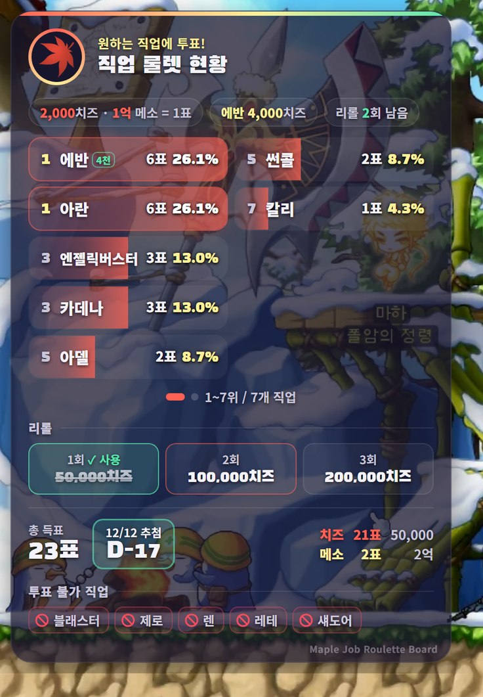
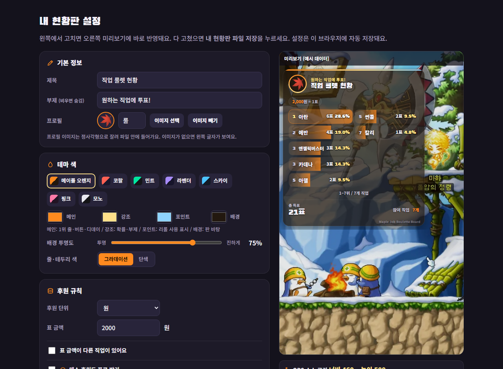

# 메이플 직업 룰렛 현황판

방송 화면(OBS)에 띄우는 **메이플스토리 직업 룰렛 후원 투표 현황판**이에요.
시청자가 후원하며 고른 직업의 표와 확률을 실시간으로 보여주고, 파일 하나로 동작해요.

<p align="center"></p>

## 바로 쓰기

| | |
|---|---|
| **내 방송에 맞게 설정하고 받기** | **https://gggip21.github.io/job-roulette-board/** |
| 기본 설정 그대로 받기 | [download/job-roulette-board.zip](https://gggip21.github.io/job-roulette-board/download/job-roulette-board.zip) |
| 사용 가이드 (PDF) | [GUIDE.pdf](https://gggip21.github.io/job-roulette-board/GUIDE.pdf) |

## 사용법 4단계

1. **설정 페이지**에서 제목·후원 규칙·투표 불가 직업·테마를 정하고 **내 현황판 파일 저장** → `roulette-board.html`
2. OBS 소스 **+ → 브라우저 → 로컬 파일**로 그 파일 선택 · 너비·높이는 설정 페이지에 나오는 **OBS 소스 크기** (기본 설정 460 × 510)
3. 후원이 오면 소스 우클릭 **→ 상호작용 → E 키**로 편집창 열고 직업 버튼 → **+1표** (프릭샷 플러스는 소스 더블클릭 → 속성 창 **상호작용** 버튼)
4. 종료 후 편집창 맨 위 **집계 완료 · 추첨 시작** → 추첨용 텍스트가 자동으로 복사됨 → 핀볼 추첨 사이트에 붙여넣으면 직업과 표 수가 그대로 들어감 (`아란*6,에반*4`)

> 치지직·SOOP·유튜브 후원은 자동 집계되지 않아 직접 입력해요. 입력한 표는 OBS 안에 저장돼 방송을 껐다 켜도 남아요.

## 할 수 있는 것

- 후원 단위(원·치즈·별풍선·직접 입력)와 표 금액, **직업별로 다른 표 금액** (금액별로 여러 그룹)
- **투표 불가·선호 직업** 지정 (누를 때마다 없음 → 투표 불가 → 선호. 선호는 판에 하트로 표시)
- 투표 불가 직업 (편집창 버튼에서 빠지고 입력도 막힘, 판 아래 표시·페이지 표시를 각각 켜고 끄기)
- **메소 후원** 표 집계 (억 단위)
- **집계 완료 · 추첨 시작** 버튼: 판에 "집계 완료" 표시, 리롤 칸이 나오고 판에서 바로 눌러 사용 처리
- **리롤** 1~3회, 회차별 금액, 투표 중에도 판에 보일지 선택 (편집창에서도 변경 가능). 추첨 모드에서 리롤 금액을 모으면 칸이 차오르고 다 모이면 자동 사용 처리
- 판에서 바로 입력: 순위표 줄에 마우스를 올려 − + 로 1표씩, 표가 없을 땐 가운데 + 로 편집창 열기
- **디데이** (마감·추첨일)
- **스킨 12종** (크리스마스·겨울 눈·레트로 픽셀·새해·벚꽃·여름 바다·할로윈·단풍·네온·별밤·종이·유리): 스킨마다 글꼴·순위 배지·줄과 막대 모양·프로필 테두리·리롤 칸·페이지 넘김·후원 효과가 달라요. 받은 뒤에도 편집창에서 변경
- 기본 스킨은 테마 색 7종 + 직접 지정, 프로필 이미지
- **편집창 탭**: 후원 입력 / 화면(제목·부제 포함) / 꾸미기
- **표시 설정은 받은 뒤에도 편집창에서 변경**: 총 후원 금액, 투표 불가·선호 직업, 리롤, 제작 표시, 직업 이름 줄여 쓰기(데슬·엔버 등), 한 페이지 개수, 넘김 간격, 배경 투명도
- **판 새로 고침**: 설정을 바꿔 받은 파일로 덮어쓴 뒤 편집창에서 누르면 방송 중에도 바로 적용
- **추첨용 복사**: 집계 완료를 누르면 핀볼 추첨 사이트에 바로 붙여넣는 형식(`아란*6,에반*4`)으로 자동 복사
- 표가 많으면 페이지 자동 넘김 (판을 클릭하거나 휠을 굴리면 바로 넘김, 마우스가 판 위에 있는 동안은 멈춤), 후원 입력 시 해당 줄 반짝임 + 알림
- **새 버전 알림·버튼 업데이트**: 새 버전이 나오면 판 위에 업데이트 창이 크게 뜨고, **지금 업데이트**를 누르면 파일을 다시 받지 않아도 최신 버전으로 바뀜(표·설정 그대로, 안 열리면 원래 파일 버전으로 자동 복귀). 업데이트 내역은 설정 페이지 맨 위
- 설정을 바꿔 새로 저장한 파일로 **덮어써도 쌓인 표는 유지**

<p align="center"></p>

## 구조 (개발자용)

```
index.html            설정·다운로드 페이지 (GitHub Pages 첫 화면)
roulette-board.html   현황판 본체 = 설정 페이지가 쓰는 템플릿 = 기본 설정 파일
GUIDE.pdf             스트리머용 사용 가이드
download/             기본 설정 zip
docs/                 README 이미지
img/                  설정 페이지 이미지
tools/guide-source.html  GUIDE.pdf 원본 (브라우저 PDF 인쇄로 생성)
```

- 현황판 설정은 `roulette-board.html` 안의 `<script id="board-config" type="application/json">` 한 곳에 들어 있어요. 설정 페이지는 이 부분만 바꿔서 새 파일을 만들어요.
- 투표 데이터는 OBS 브라우저 소스의 `localStorage` (`mapleJobRouletteBoard.v1`)에 저장돼요. 서버나 외부 전송은 없어요. 새 버전 확인을 위해 `version.json`만 읽어 와요(보내는 데이터 없음).
- 버전을 올릴 때는 `roulette-board.html`의 `BOARD_VER`와 `version.json` 맨 앞 항목을 같이 고쳐요.
- 버튼 업데이트는 사이트의 `roulette-board.html`을 OBS 안(`mapleJobRouletteBoard.code`)에 저장해 두고, 받은 파일보다 새 버전이면 그 코드에 파일의 설정을 넣어 실행해요. 실행 신호가 없으면 그 버전을 막고(`mapleJobRouletteBoard.codeBad`) 파일 버전으로 돌아가요.
- 빌드 도구 없이 html·css·js만 써요.

---

메이플스토리 팬메이드 도구이며 넥슨의 공식 도구가 아니에요. 메이플스토리 및 직업 이름의 권리는 넥슨코리아에 있어요.
